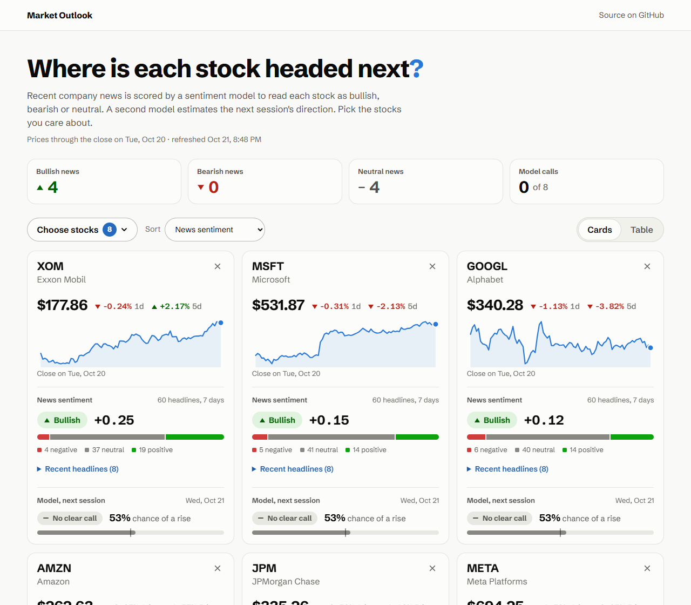
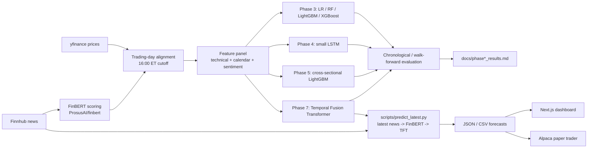

# Sentiment Stock Predictor

Research project: financial news headlines are scored with FinBERT (`ProsusAI/finbert`), combined with technical and calendar features, and fed to a Temporal Fusion Transformer (TFT) that produces multi-horizon (1, 3, 5 and 7 trading day) forecasts with quantile bands. The repo also contains the earlier baseline phases (logistic regression, random forest, LightGBM, XGBoost, a small LSTM, cross-sectional features), a Next.js dashboard, and an Alpaca paper-trading pipeline.



**Live dashboard: https://shreyask06.github.io/SentimentStockPredictorModel/** shows, for each stock you pick, the Phase 8 model's next-session outlook (bullish, bearish or no clear call, with the probability of a rise), the recent headlines scored by the fine-tuned sentiment model, and the price trend. It is built from `site/`, deployed by GitHub Actions on pushes to `main`, and refreshed with `python scripts/export_dashboard_data.py`.

## At a glance

Fine-tuned `distilbert-base-uncased` for three-class financial sentiment on Financial PhraseBank (train 3,385 / val 725 / test 726):

| Evaluation | Accuracy |
|---|---|
| Validation split (used to select learning rate and epochs) | **87.0%** |
| 5-fold cross-validation on train + val | **85.4% +/- 0.8%** |
| Held-out test split (scored once, after all choices were frozen) | **82.5%** (95% bootstrap CI 79.8-85.3%) |
| Cross-dataset: financial tweets, never trained on | 70.2% |
| Baselines on the test split: majority class / TF-IDF + logistic regression | 59.4% / 77.1% |

Held-out test and cross-validation results agree at roughly 82-85%, and the test split was scored exactly once after every choice was frozen. Full protocol and per-class results: [docs/phase9_finetune_results.md](docs/phase9_finetune_results.md).

## Latest work

**Phase 9: fine-tuned sentiment model and project website.** `distilbert-base-uncased` is fine-tuned for three-class (positive / negative / neutral) financial sentiment on Financial PhraseBank, with a held-out test split, cross-validation and an independent cross-dataset check. See [docs/phase9_finetune_results.md](docs/phase9_finetune_results.md). Run: `python scripts/run_phase9_finetune.py`; predict with `src/models/sentiment_ft.py`. A static dashboard lives in `site/` (Vite + React + TypeScript, GitHub Pages ready): choose stocks and see each one's outlook, news tone and price trend. Run it with `cd site && npm install && npm run dev`; refresh its numbers with `python scripts/export_dashboard_data.py`. It also includes an optional box that scores any headline with the fine-tuned model in the browser (ONNX Runtime); rebuild those model files after retraining with `python scripts/export_site_model.py`. See [site/README.md](site/README.md).

**Phase 8: news-sentiment up/down classifier.** Headlines (FNSPID 2009-2023 for 28 tickers; Finnhub for live inference) are scored with FinBERT and fed to calibrated classifiers that predict next-trading-day direction and abstain unless confident, with a locked, run-once held-out test. Details and caveats: [docs/phase8_results.md](docs/phase8_results.md). Run: `python scripts/phase8_build_fnspid_dataset.py` (data), `python scripts/phase8_build_features.py score|build --source fnspid` (FinBERT features), `python scripts/run_phase8_models.py cv` then `final`, `python scripts/predict_news_direction.py` (live UP/DOWN/ABSTAIN; needs `FINNHUB_API_KEY` in `.env`, otherwise uses cached news). Tests: `python -m pytest tests -q`.

**This is a research project, not a trading system.** The stock-direction models have not shown a predictive edge over a majority-class baseline. Nothing here should be read as evidence that they can predict prices. Per-phase results, splits and caveats are in the `docs/phase*_results.md` files.

## Architecture



The paper trader currently wraps the Phase 3 style direction model (see [paper-trader/README.md](paper-trader/README.md)). Feeding TFT output into the dashboard and paper trader is the intended direction of the diagram, not a claim about what is deployed today.

## Pipeline stages

| Phase | What | Script | Results doc |
|---|---|---|---|
| 1 | Price panel (yfinance) and Finnhub news archive for a 28-ticker universe | `scripts/run_phase1_pipeline.py` | none |
| 2 | FinBERT headline scoring, daily sentiment aggregation, feature matrix | `scripts/run_phase2_pipeline.py` | none |
| 3 | Logistic regression, random forest, LightGBM, XGBoost baselines; confidence-threshold sweep; technical vs sentiment ablation | `scripts/run_phase3_baselines.py` | [docs/phase3_results.md](docs/phase3_results.md) |
| 3b | Same baselines restricted to the sentiment-covered window (2025-08-08 to 2025-12-16) | `scripts/run_phase3_recent_window_baseline.py` | [docs/phase3_recent_window_results.md](docs/phase3_recent_window_results.md) |
| 4 | Small LSTM (10-day lookback, hidden size 16) | `scripts/run_phase4_lstm.py` | [docs/phase4_lstm_results.md](docs/phase4_lstm_results.md) |
| 5 | Cross-sectional rank/z-score features, alternative 20d/4% label (LightGBM) | `scripts/run_phase5_cross_sectional_baselines.py` | [docs/phase5_cross_sectional_results.md](docs/phase5_cross_sectional_results.md) |
| 7 | FinBERT + TFT, multi-horizon quantile forecasts, staged experiments and sentiment ablation | `scripts/build_tft_panel.py`, `scripts/run_phase7_tft.py`, `scripts/predict_latest.py` | [docs/phase7_tft_results.md](docs/phase7_tft_results.md) |

Helper scripts: `build_extended_feature_matrix.py`, `fetch_ticker_history.py`, `add_7day_label.py`, `run_rf_robustness_check.py`, `run_sentiment_coverage_analysis.py`. A Reddit sentiment experiment is in progress and is not part of any reported result.

## Repository layout

```
.
├── src/
│   ├── config.py            # paths, date range, env var loading
│   ├── data/                # prices, news (Finnhub), calendar, tickers, storage, dataset builders
│   │   └── tft_dataset.py   # Phase 7 per-ticker panel (time_idx, covariates, multi-horizon targets)
│   ├── features/            # technical, sentiment (FinBERT), trading_day, labels, cross_sectional
│   └── models/              # splits, train, evaluate, ablation, regimes, sequences, train_lstm
│       └── tft.py           # Phase 7 Temporal Fusion Transformer
├── scripts/                 # run_phase*.py entry points and helpers
├── tests/                   # pytest suite for src/ (data, features, models)
├── docs/                    # per-phase results and the Phase 7 plan
├── dashboard/               # Next.js app (see dashboard/README.md)
├── paper-trader/            # Alpaca paper-trading pipeline (see paper-trader/README.md)
├── .github/workflows/       # daily.yml (paper-trading cron), pr-checks.yml
├── data/                    # raw/ and processed/ (gitignored)
└── requirements.txt
```

## Setup (Windows)

```powershell
python -m venv .venv
.venv\Scripts\activate
pip install -r requirements.txt
```

Phase 7 additionally needs `pytorch-forecasting==1.7.0` and `lightning==2.6.5` (pinned in `requirements.txt`) and a recent `torch` (developed on torch 2.11, CPU only).

Create a `.env` at the repo root (copy `.env.example`):

| Variable | Needed for |
|---|---|
| `FINNHUB_API_KEY` | News fetch and live inference (`predict_latest.py`). A free Finnhub key is sufficient. |
| `ALPACA_KEY_ID`, `ALPACA_SECRET_KEY`, `ALPACA_PAPER_BASE_URL` | Paper trading only, as documented in [paper-trader/README.md](paper-trader/README.md). The URL must be the paper endpoint. |
| `NEXT_PUBLIC_SUPABASE_URL`, `NEXT_PUBLIC_SUPABASE_ANON_KEY`, `FINNHUB_API_KEY`, `HF_TOKEN` | Dashboard only. These are the names the dashboard code reads; `dashboard/README.md` is still the create-next-app template and does not list them. Set them in `dashboard/.env.local`. |

No other API keys are needed for the research pipeline. FinBERT weights download from Hugging Face without authentication. Docker is not required. `.env` and `telegram_ingest.session` must never be committed.

## Running each phase

```powershell
# Phases 1-2: data and features (Finnhub key needed for the news pull)
python scripts/run_phase1_pipeline.py
python scripts/run_phase2_pipeline.py

# Phases 3-5: baselines (each writes its docs/ results file)
python scripts/run_phase3_baselines.py
python scripts/run_phase3_recent_window_baseline.py
python scripts/run_phase4_lstm.py
python scripts/run_phase5_cross_sectional_baselines.py

# Phase 7: TFT
python scripts/build_tft_panel.py        # build the per-ticker panel
python scripts/run_phase7_tft.py         # staged experiments; CPU, long-running
python scripts/predict_latest.py         # latest news -> FinBERT -> TFT forecast; needs FINNHUB_API_KEY, degrades gracefully without it

# Tests
python -m pytest tests -q   # run paper-trader tests separately: cd paper-trader; python -m pytest -q
```

Dashboard: `cd dashboard; npm install; npm run dev`. Paper trader: `cd paper-trader; python -m paper_trader.pipeline --dry-run`.

## Results

Per-phase results, including splits, baselines and confidence intervals, are in [docs/phase3_results.md](docs/phase3_results.md), [docs/phase3_recent_window_results.md](docs/phase3_recent_window_results.md), [docs/phase4_lstm_results.md](docs/phase4_lstm_results.md), [docs/phase5_cross_sectional_results.md](docs/phase5_cross_sectional_results.md), [docs/phase7_tft_results.md](docs/phase7_tft_results.md), [docs/phase8_results.md](docs/phase8_results.md) and [docs/phase9_finetune_results.md](docs/phase9_finetune_results.md).

Summary of what was learned: no stock-direction model in Phases 3 to 8 showed a predictive edge over its matched majority-class baseline on held-out data. Some configurations looked slightly better on validation and did not hold up on the test set; an earlier apparent win in Phase 3 was an evaluation artifact (confident-subset accuracy compared with the full-set majority rate), fixed by adding `local_majority_baseline` to `src/models/evaluate.py`. The FinBERT sentiment question for the Phase 7 TFT is inconclusive by construction, because the archived news did not cover the training window.

## Methodology and leakage controls

- Chronological splits. Phases 3 to 5 (full history): train through 2022-12-31, validation 2023, held-out test 2024-2025 (`TRAIN_END = "2022-12-31"`, `VALIDATE_END = "2023-12-31"` in the phase scripts, implemented by `time_split` in `src/models/splits.py`). The recent-window experiments use a smaller chronological split inside 2025-08-08 to 2025-12-16. The Phase 3 to 5 scripts use one chronological train/validation/test split rather than rolling folds; Phase 7 adds walk-forward folds.
- Test sets are evaluated once. The confidence threshold and other choices are selected on validation only, then applied unchanged to the test set.
- Features at day t use only data available at the close of t. News published after 16:00 ET (`MARKET_CLOSE_ET` in `src/features/trading_day.py`) is assigned to the next trading day.
- The Phase 3 to 5 direction label is whether price first moves +2% or -2% within a 10 trading day horizon (`src/features/labels.py`); rows where neither threshold is hit are dropped. Phase 5 also tests a 20-day, 4% label. Phase 7 targets are 1/3/5/7-day forward returns and their direction.
- Local (confident-subset) majority baseline: when a model only predicts on rows where its probability is at least the threshold (or at most 1 minus it), accuracy is compared with the majority-class rate inside that same subset, not the full test set. Comparing against the full-set rate can make a model look better than it is when its confident predictions skew toward one class.
- Every reported number should state its split and sit next to its baseline; validation or cross-validation and held-out numbers are reported together.

## Known limitations

- FinBERT news coverage is very thin: about 225-248 archived articles per ticker, covering only the last few weeks of 2025 for most tickers (earliest 2025-08-08 for EOG; 2025-11-05 or later for every ticker in the Phase 7 subset). The root cause is that `src/data/news.py` requests one calendar-year chunk per Finnhub call, and Finnhub returns only about the latest 250 articles per request. Sentiment therefore has no variation in any training window, so the Phase 7 sentiment ablation is inconclusive by construction. Fetching news in weekly or daily chunks is the fix.
- Small universe of 28 large-cap US tickers, chosen by hand, which introduces survivorship bias (current large caps only).
- CPU-only training with small models (for example a hidden size 16 LSTM and a CPU-feasible TFT). Larger models and broader searches were not tried.
- Accuracy metrics ignore transaction costs and slippage.
- Confident-subset accuracies are often computed on few predictions, so they are noisy.
- Phases 3 to 5 do not use rolling walk-forward folds, so one validation year and one test period give limited evidence.

## Dashboard

Next.js 15 app in [dashboard/](dashboard/) with Supabase auth. Pages include stocks (search and per-ticker detail), predictions, weekly, twenty-day, volatility, paper-trading and about, plus an in-app chat assistant. It presents model output and market data; it does not train models. Its environment variables are listed in [Setup](#setup-windows). `dashboard/README.md` is currently the unmodified create-next-app template. Run with `npm run dev` from `dashboard/`.

## Paper trading

[paper-trader/](paper-trader/) runs a daily pipeline against Alpaca's paper API (no real money). It logs a prediction for every universe ticker, trades only when model confidence is at least 0.6 and the sentiment signal agrees (longs only by default), resolves outcomes after each horizon, and writes an evaluation report comparing hit rate with coin-flip and always-up baselines. Its own README states that the model has never shown an edge over the always-up baseline. Three strategies run side by side: `direction-daily` (trades), and `volatility` and `post-event` (log-only placeholders). Scheduling is via `.github/workflows/daily.yml`; PRs touching `paper-trader/`, `src/` or `requirements.txt` run tests and a dry run via `pr-checks.yml`. See [paper-trader/README.md](paper-trader/README.md) for details and limitations.

## Disclaimer

This repository is for research and education only. It is not financial advice, and nothing in it is a recommendation to buy or sell any security. Past performance, backtests and paper-trading results do not indicate future results. Use at your own risk.
