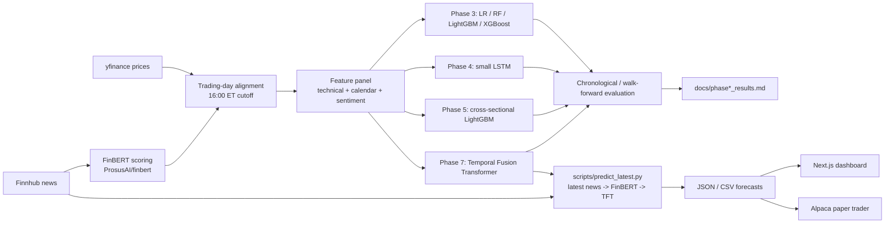

# Sentiment Stock Predictor

Research project: financial news headlines are scored with FinBERT (`ProsusAI/finbert`), combined with technical and calendar features, and fed to a Temporal Fusion Transformer (TFT) that produces multi-horizon (1, 3, 5 and 7 trading day) forecasts with quantile bands. The repo also contains the earlier baseline phases (logistic regression, random forest, LightGBM, XGBoost, a small LSTM, cross-sectional features), a Next.js dashboard, and an Alpaca paper-trading pipeline.

## Phase 9: fine-tuned sentiment model and project website (latest)

**Sentiment classification** (positive / negative / neutral on financial text): `distilbert-base-uncased` fine-tuned on Financial PhraseBank (`sentences_50agree`, 4,836 deduplicated sentences, stratified 70/15/15 split). Held-out test accuracy (n=726, evaluated once): **82.5%** (95% CI 79.8-85.3%), against 59.4% majority class and 30.6% for an untuned classification head. 5-fold CV on train+val: 85.4% +/- 0.8%. On an independent dataset (Twitter financial news sentiment, 11,924 rows, never used for training or selection) it scores 70.2%, versus 71.5% for ProsusAI/finbert as-is; FinBERT was trained on PhraseBank, so its 86.9% on the PhraseBank test split is not independent evidence. This is **sentiment-classification accuracy, not stock-direction accuracy**; the stock-direction result is Phase 8 below. Details: [docs/phase9_finetune_results.md](docs/phase9_finetune_results.md). Run: `python scripts/run_phase9_finetune.py`; predict with `src/models/sentiment_ft.py`.

**Website** (`site/`, Vite + React + TypeScript, static, GitHub Pages ready): results explorer, pipeline diagram, precomputed headline demo. `cd site && npm install && npm run dev`; refresh data with `python scripts/export_site_data.py`. See [site/README.md](site/README.md).

## Phase 8: news-sentiment up/down classifier

Headlines (FNSPID 2009-2023, 162,704 articles, 28 tickers; Finnhub for live inference) are scored with FinBERT and fed to calibrated classifiers that predict next-trading-day direction and **abstain unless confident**. Target was ~85% accuracy on confident calls; **it was not reached.** Held-out test (2022-01-01..2023-12-16, n=7,578, run once): unrestricted accuracy 0.517-0.520 vs 0.520 majority rate; primary model (`b_emb`) confident-call accuracy 0.505 (95% CI 0.473-0.537) at 36% coverage vs 0.505 local baseline. Walk-forward CV (2017-2021) pooled confident accuracy for the primary: 0.522 (0.495-0.548) at 39% coverage vs 0.517. No edge; full tables, splits and caveats in [docs/phase8_results.md](docs/phase8_results.md).

Run it: `python scripts/phase8_build_fnspid_dataset.py` (data), `python scripts/phase8_build_features.py score|build --source fnspid` (FinBERT features), `python scripts/run_phase8_models.py cv` then `final` (final runs the test once and locks), `python scripts/predict_news_direction.py` (live UP/DOWN/ABSTAIN from latest Finnhub news; needs `FINNHUB_API_KEY` in `.env`, otherwise uses cached news). Tests: `python -m pytest tests -q`.

**This is a research project, not a trading system.** Across Phases 3 to 5, no model's measured directional accuracy beat its matched majority-class baseline (see [Results](#results)). Phase 7 (TFT) did not beat it either. On held-out test (2024-2025), every stage scored between 1.7 and 4.5 points below the majority baseline. See [docs/phase7_tft_results.md](docs/phase7_tft_results.md). Nothing here should be read as evidence of a predictive edge.

## Architecture



The paper trader currently wraps the Phase 3 style direction model (see [paper-trader/README.md](paper-trader/README.md)). Feeding TFT output into the dashboard and paper trader is the intended direction of the diagram, not a claim about what is deployed today.

## Pipeline stages

| Phase | What | Script | Results doc |
|---|---|---|---|
| 1 | Price panel (yfinance) and Finnhub news archive for a 28-ticker universe | `scripts/run_phase1_pipeline.py` | none |
| 2 | FinBERT headline scoring, daily sentiment aggregation, feature matrix | `scripts/run_phase2_pipeline.py` | none |
| 3 | Logistic regression, random forest, LightGBM, XGBoost baselines; confidence-threshold sweep; technical vs sentiment ablation | `scripts/run_phase3_baselines.py` | [docs/phase3_results.md](docs/phase3_results.md) |
| 3b | Same baselines restricted to the sentiment-covered window (2025-08-08 to 2025-12-16) | `scripts/run_phase3_recent_window_baseline.py` | [docs/phase3_recent_window_results.md](docs/phase3_recent_window_results.md) |
| 4 | Small LSTM (10-day lookback, hidden size 16) | `scripts/run_phase4_lstm.py` | [docs/phase4_lstm_results.md](docs/phase4_lstm_results.md) |
| 5 | Cross-sectional rank/z-score features, alternative 20d/4% label (LightGBM) | `scripts/run_phase5_cross_sectional_baselines.py` | [docs/phase5_cross_sectional_results.md](docs/phase5_cross_sectional_results.md) |
| 7 | FinBERT + TFT, multi-horizon quantile forecasts, staged experiments and sentiment ablation | `scripts/build_tft_panel.py`, `scripts/run_phase7_tft.py`, `scripts/predict_latest.py` | [docs/phase7_tft_results.md](docs/phase7_tft_results.md) |

Helper scripts: `build_extended_feature_matrix.py`, `fetch_ticker_history.py`, `add_7day_label.py`, `run_rf_robustness_check.py`, `run_sentiment_coverage_analysis.py`. A Reddit sentiment experiment is in progress and is not part of any reported result.

## Repository layout

```
.
├── src/
│   ├── config.py            # paths, date range, env var loading
│   ├── data/                # prices, news (Finnhub), calendar, tickers, storage, dataset builders
│   │   └── tft_dataset.py   # Phase 7 per-ticker panel (time_idx, covariates, multi-horizon targets)
│   ├── features/            # technical, sentiment (FinBERT), trading_day, labels, cross_sectional
│   └── models/              # splits, train, evaluate, ablation, regimes, sequences, train_lstm
│       └── tft.py           # Phase 7 Temporal Fusion Transformer
├── scripts/                 # run_phase*.py entry points and helpers
├── tests/                   # pytest suite for src/ (data, features, models)
├── docs/                    # per-phase results and the Phase 7 plan
├── dashboard/               # Next.js app (see dashboard/README.md)
├── paper-trader/            # Alpaca paper-trading pipeline (see paper-trader/README.md)
├── .github/workflows/       # daily.yml (paper-trading cron), pr-checks.yml
├── data/                    # raw/ and processed/ (gitignored)
└── requirements.txt
```

## Setup (Windows)

```powershell
python -m venv .venv
.venv\Scripts\activate
pip install -r requirements.txt
```

Phase 7 additionally needs `pytorch-forecasting==1.7.0` and `lightning==2.6.5` (pinned in `requirements.txt`) and a recent `torch` (developed on torch 2.11, CPU only).

Create a `.env` at the repo root (copy `.env.example`):

| Variable | Needed for |
|---|---|
| `FINNHUB_API_KEY` | News fetch and live inference (`predict_latest.py`). A free Finnhub key is sufficient. |
| `ALPACA_KEY_ID`, `ALPACA_SECRET_KEY`, `ALPACA_PAPER_BASE_URL` | Paper trading only, as documented in [paper-trader/README.md](paper-trader/README.md). The URL must be the paper endpoint. |
| `NEXT_PUBLIC_SUPABASE_URL`, `NEXT_PUBLIC_SUPABASE_ANON_KEY`, `FINNHUB_API_KEY`, `HF_TOKEN` | Dashboard only. These are the names the dashboard code reads; `dashboard/README.md` is still the create-next-app template and does not list them. Set them in `dashboard/.env.local`. |

No other API keys are needed for the research pipeline. FinBERT weights download from Hugging Face without authentication. Docker is not required. `.env` and `telegram_ingest.session` must never be committed.

## Running each phase

```powershell
# Phases 1-2: data and features (Finnhub key needed for the news pull)
python scripts/run_phase1_pipeline.py
python scripts/run_phase2_pipeline.py

# Phases 3-5: baselines (each writes its docs/ results file)
python scripts/run_phase3_baselines.py
python scripts/run_phase3_recent_window_baseline.py
python scripts/run_phase4_lstm.py
python scripts/run_phase5_cross_sectional_baselines.py

# Phase 7: TFT
python scripts/build_tft_panel.py        # build the per-ticker panel
python scripts/run_phase7_tft.py         # staged experiments; CPU, long-running
python scripts/predict_latest.py         # latest news -> FinBERT -> TFT forecast; needs FINNHUB_API_KEY, degrades gracefully without it

# Tests
python -m pytest tests -q   # run paper-trader tests separately: cd paper-trader; python -m pytest -q
```

Dashboard: `cd dashboard; npm install; npm run dev`. Paper trader: `cd paper-trader; python -m paper_trader.pipeline --dry-run`.

## Results

All Phase 3 to 5 numbers below are copied from the docs named in the last column. "Accuracy" is accuracy on the confident subset (coverage = fraction of rows predicted). "Local majority baseline" is the majority-class rate within that same subset; a model only counts as beating the baseline if its accuracy exceeds it. The confidence threshold is 0.6 unless noted. Test sets were evaluated once.

### Held-out test results

| Phase / experiment | Model | Split | Accuracy | Coverage | Local majority baseline | Beats baseline? | Source |
|---|---|---|---|---|---|---|---|
| 3, full history | Logistic regression | held-out test 2024-2025 | 0.494 | 0.013 | 0.513 | No | phase3_results.md |
| 3, full history | LightGBM | held-out test 2024-2025 | 0.528 | 0.330 | 0.562 | No | phase3_results.md |
| 3, full history | Random forest | held-out test 2024-2025 | 0.594 | 0.012 | 0.613 | No | phase3_results.md |
| 3, full history | XGBoost | held-out test 2024-2025 | 0.492 | 0.554 | 0.556 | No | phase3_results.md |
| 3b, recent window | Logistic regression | held-out test 2025-11-19 to 2025-12-16 | 0.537 | 0.748 | 0.618 | No | phase3_recent_window_results.md |
| 3b, recent window | LightGBM | held-out test 2025-11-19 to 2025-12-16 | 0.548 | 0.807 | 0.621 | No | phase3_recent_window_results.md |
| 3b, recent window | Random forest | held-out test 2025-11-19 to 2025-12-16 | 0.652 | 0.361 | 0.646 | Marginally (+0.6 pp, n=178; the doc calls this noise) | phase3_recent_window_results.md |
| 3b, recent window | XGBoost | held-out test 2025-11-19 to 2025-12-16 | 0.537 | 0.876 | 0.637 | No | phase3_recent_window_results.md |
| 4, full history | LSTM | held-out test 2024-01-16 to 2025-12-16 | 0.564 | 0.063 | 0.565 | No | phase4_lstm_results.md |
| 4, recent window | LSTM | held-out test 2025-12-03 to 2025-12-16 | 0.364 | 0.137 | 0.606 | No | phase4_lstm_results.md |
| 5, original features | LightGBM | held-out test | 0.528 | 0.330 | 0.562 | No | phase5_cross_sectional_results.md |
| 5, + cross-sectional features | LightGBM | held-out test | 0.511 | 0.332 | 0.549 | No | phase5_cross_sectional_results.md |
| 5, 20d/4% label + cross-sectional | LightGBM | held-out test | 0.520 | 0.474 | 0.592 | No | phase5_cross_sectional_results.md |

### Validation results for the same experiments

| Phase / experiment | Model | Split | Accuracy | Coverage | Local majority baseline | Source |
|---|---|---|---|---|---|---|
| 3, full history (threshold 0.5) | Logistic regression | validation 2023 | 0.527 | 1.000 | 0.536 | phase3_results.md |
| 3, full history (threshold 0.5) | LightGBM | validation 2023 | 0.532 | 1.000 | 0.536 | phase3_results.md |
| 3, full history (threshold 0.5) | Random forest | validation 2023 | 0.546 | 1.000 | 0.536 | phase3_results.md |
| 3, full history (threshold 0.5) | XGBoost | validation 2023 | 0.527 | 1.000 | 0.536 | phase3_results.md |
| 3b, recent window (threshold 0.5) | Logistic regression | validation 2025-10-24 to 2025-11-18 | 0.527 | 1.000 | 0.514 | phase3_recent_window_results.md |
| 3b, recent window (threshold 0.5) | LightGBM | validation 2025-10-24 to 2025-11-18 | 0.490 | 1.000 | 0.514 | phase3_recent_window_results.md |
| 3b, recent window (threshold 0.5) | Random forest | validation 2025-10-24 to 2025-11-18 | 0.503 | 1.000 | 0.514 | phase3_recent_window_results.md |
| 3b, recent window (threshold 0.5) | XGBoost | validation 2025-10-24 to 2025-11-18 | 0.508 | 1.000 | 0.514 | phase3_recent_window_results.md |
| 4, full history (threshold 0.6) | LSTM | validation 2023 | 0.534 | 0.068 | 0.566 | phase4_lstm_results.md |
| 4, recent window (threshold 0.6) | LSTM | validation (2025 recent window) | 0.303 | 0.325 | 0.621 | phase4_lstm_results.md |
| 5, original features | LightGBM | validation 2023 | 0.553 | 0.368 | 0.550 | phase5_cross_sectional_results.md |
| 5, + cross-sectional features | LightGBM | validation 2023 | 0.573 | 0.367 | 0.552 | phase5_cross_sectional_results.md |
| 5, 20d/4% label + cross-sectional | LightGBM | validation 2023 | 0.577 | 0.509 | 0.567 | phase5_cross_sectional_results.md |

Reading these together: some configurations looked slightly better than their baseline on validation (Phase 3 random forest at threshold 0.5, the Phase 5 variants) and then fell below it on the held-out test. The Phase 3b random forest result (+0.6 pp over 178 predictions) is within noise by the project's own assessment. An earlier apparent random forest win in Phase 3 was an evaluation artifact: accuracy on a confident subset had been compared against the full-set majority rate. `local_majority_baseline` was added to `src/models/evaluate.py` to fix this, and the numbers above use the corrected comparison. The LightGBM ablation of technical vs sentiment features showed no meaningful difference in either window (see the Phase 3 docs).

### Phase 7 (TFT)

<!-- PHASE7_RESULTS_START -->
Temporal Fusion Transformer, mean directional accuracy over horizons 1/3/5/7 days, 16-ticker subset, single seed. CV = walk-forward folds F1-F3 (2021-2023); held-out test = 2024-01-01..2025-12-31. Each accuracy sits next to the majority-class baseline of the same rows.

| Stage | CV mean acc vs majority | Held-out test acc vs majority | Test minus majority |
|---|---|---|---|
| (a) price-only | 0.540 vs 0.536 | 0.539 vs 0.561 | -0.022 |
| (b) + technical | 0.503 vs 0.536 | 0.516 vs 0.561 | -0.045 |
| (c) + FinBERT sentiment | 0.534 vs 0.536 | 0.543 vs 0.561 | -0.019 |
| (d) tuned hyperparameters | 0.537 vs 0.536 | 0.541 vs 0.561 | -0.021 |
| (e) + confidence threshold (confident subset vs its local majority) | 0.551 vs 0.536 | 0.539 vs 0.556 | -0.017 |
| LightGBM, same target | 0.521 vs 0.536 | 0.524 vs 0.561 | -0.037 |

No configuration beat the majority-class baseline on held-out test; the primary stages d and e are 2.1 and 1.7 points below it, with 95% block-bootstrap CIs for the mean over horizons that include zero (d: -0.042 to +0.005). The stage d/e validation gains on fold F3 were selection effects and did not carry to F1, F2 or test. The FinBERT sentiment question is inconclusive by construction, not negative: the archived news covers only the last weeks of 2025 (the news fetch keeps about the latest 250 articles per request), so the models never saw a non-zero sentiment value in training. Full details, CIs and tuning log: [docs/phase7_tft_results.md](docs/phase7_tft_results.md).
<!-- PHASE7_RESULTS_END -->

## Methodology and leakage controls

- Chronological splits. Phases 3 to 5 (full history): train through 2022-12-31, validation 2023, held-out test 2024-2025 (`TRAIN_END = "2022-12-31"`, `VALIDATE_END = "2023-12-31"` in the phase scripts, implemented by `time_split` in `src/models/splits.py`). The recent-window experiments use a smaller chronological split inside 2025-08-08 to 2025-12-16. The Phase 3 to 5 scripts use one chronological train/validation/test split rather than rolling folds; Phase 7 adds walk-forward folds.
- Test sets are evaluated once. The confidence threshold and other choices are selected on validation only, then applied unchanged to the test set.
- Features at day t use only data available at the close of t. News published after 16:00 ET (`MARKET_CLOSE_ET` in `src/features/trading_day.py`) is assigned to the next trading day.
- The Phase 3 to 5 direction label is whether price first moves +2% or -2% within a 10 trading day horizon (`src/features/labels.py`); rows where neither threshold is hit are dropped. Phase 5 also tests a 20-day, 4% label. Phase 7 targets are 1/3/5/7-day forward returns and their direction.
- Local (confident-subset) majority baseline: when a model only predicts on rows where its probability is at least the threshold (or at most 1 minus it), accuracy is compared with the majority-class rate inside that same subset, not the full test set. Comparing against the full-set rate can make a model look better than it is when its confident predictions skew toward one class.
- Every reported number should state its split and sit next to its baseline; validation or cross-validation and held-out numbers are reported together.

## Known limitations

- FinBERT news coverage is very thin: about 225-248 archived articles per ticker, covering only the last few weeks of 2025 for most tickers (earliest 2025-08-08 for EOG; 2025-11-05 or later for every ticker in the Phase 7 subset). The root cause is that `src/data/news.py` requests one calendar-year chunk per Finnhub call, and Finnhub returns only about the latest 250 articles per request. Sentiment therefore has no variation in any training window, so the Phase 7 sentiment ablation is inconclusive by construction. Fetching news in weekly or daily chunks is the fix.
- Small universe of 28 large-cap US tickers, chosen by hand, which introduces survivorship bias (current large caps only).
- CPU-only training with small models (for example a hidden size 16 LSTM and a CPU-feasible TFT). Larger models and broader searches were not tried.
- Accuracy metrics ignore transaction costs and slippage.
- Confident-subset accuracies are often computed on few predictions, so they are noisy.
- Phases 3 to 5 do not use rolling walk-forward folds, so one validation year and one test period give limited evidence.

## Dashboard

Next.js 15 app in [dashboard/](dashboard/) with Supabase auth. Pages include stocks (search and per-ticker detail), predictions, weekly, twenty-day, volatility, paper-trading and about, plus an in-app chat assistant. It presents model output and market data; it does not train models. Its environment variables are listed in [Setup](#setup-windows). `dashboard/README.md` is currently the unmodified create-next-app template. Run with `npm run dev` from `dashboard/`.

## Paper trading

[paper-trader/](paper-trader/) runs a daily pipeline against Alpaca's paper API (no real money). It logs a prediction for every universe ticker, trades only when model confidence is at least 0.6 and the sentiment signal agrees (longs only by default), resolves outcomes after each horizon, and writes an evaluation report comparing hit rate with coin-flip and always-up baselines. Its own README states that the model has never shown an edge over the always-up baseline. Three strategies run side by side: `direction-daily` (trades), and `volatility` and `post-event` (log-only placeholders). Scheduling is via `.github/workflows/daily.yml`; PRs touching `paper-trader/`, `src/` or `requirements.txt` run tests and a dry run via `pr-checks.yml`. See [paper-trader/README.md](paper-trader/README.md) for details and limitations.

## Disclaimer

This repository is for research and education only. It is not financial advice, and nothing in it is a recommendation to buy or sell any security. Past performance, backtests and paper-trading results do not indicate future results. Use at your own risk.
