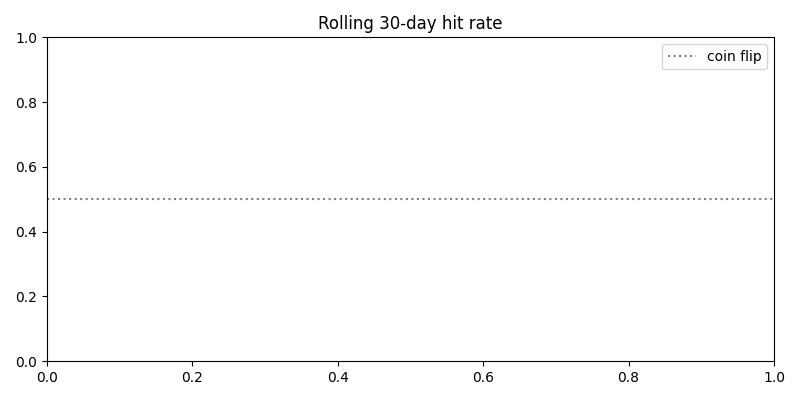
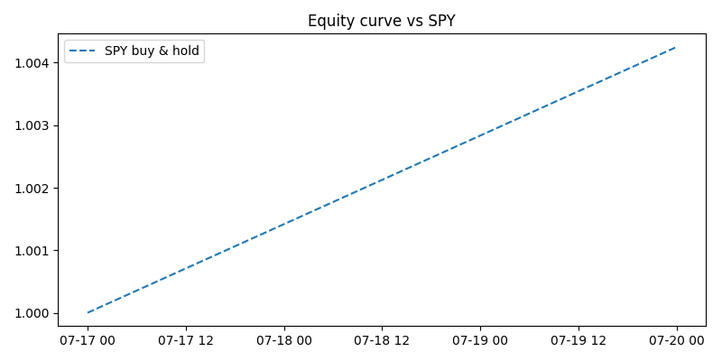
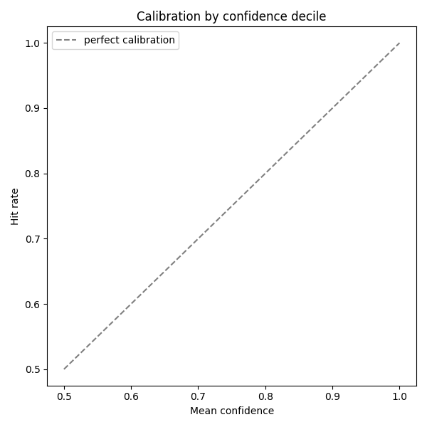

# Paper Trading Report

Date range: 2026-07-17 to 2026-07-20

## Strategy: direction-daily

- All predictions: n=0, hit rate=n/a, coin-flip baseline=50.0% (p=n/a), always-up baseline=n/a (p=n/a)

- Traded-only: n=0, hit rate=n/a, always-up baseline=n/a (p=n/a)

- Portfolio: n/a (no closed trades yet)

**Conclusion**: not enough resolved outcomes yet to evaluate.

## Strategy: volatility

- All predictions: n=0, hit rate=n/a, coin-flip baseline=50.0% (p=n/a), always-up baseline=n/a (p=n/a)

- Traded-only: n=0, hit rate=n/a, always-up baseline=n/a (p=n/a)

- Portfolio: n/a (no closed trades yet)

**Conclusion**: not enough resolved outcomes yet to evaluate.

## Strategy: post-event

- All predictions: n=0, hit rate=n/a, coin-flip baseline=50.0% (p=n/a), always-up baseline=n/a (p=n/a)

- Traded-only: n=0, hit rate=n/a, always-up baseline=n/a (p=n/a)

- Portfolio: n/a (no closed trades yet)

**Conclusion**: not enough resolved outcomes yet to evaluate.

## Strategy: weekly

- All predictions: n=0, hit rate=n/a, coin-flip baseline=50.0% (p=n/a), always-up baseline=n/a (p=n/a)

- Traded-only: n=0, hit rate=n/a, always-up baseline=n/a (p=n/a)

- Portfolio: n/a (no closed trades yet)

**Conclusion**: not enough resolved outcomes yet to evaluate.

## Strategy: twenty-day

- All predictions: n=0, hit rate=n/a, coin-flip baseline=50.0% (p=n/a), always-up baseline=n/a (p=n/a)

- Traded-only: n=0, hit rate=n/a, always-up baseline=n/a (p=n/a)

- Portfolio: n/a (no closed trades yet)

**Conclusion**: not enough resolved outcomes yet to evaluate.

